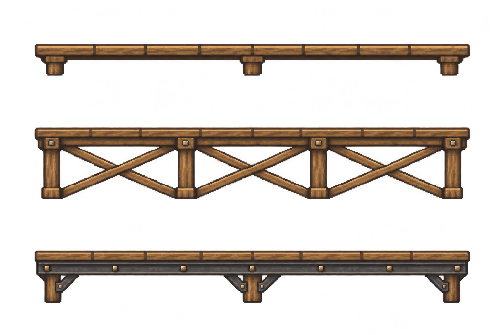

# 시설 기단 후보 — 미적용 시안



위부터 낮은 목재 마루, X자 목재 버팀, 철제 보강 마루다. 사용자가 3번 철제 보강 마루형을 선택했다. 이후 실제 시설 기단은 이 디자인을 공통 기준으로 한다. 공통 널판의 두께·색과 걸을 수 있는 윗면 높이를 통일한다.

이 이미지는 형태 비교용 콘셉트이며 게임 자원으로 임포트하지 않았다. 최종 제작 때는 기존 픽셀 밀도와 투명 외곽을 적용한다. 건물 바닥과 재배대, 지형 생성, 시설 간격, S/아래 방향키로 발판 통과 기능은 사용자가 구현을 진행하라고 할 때까지 보류한다.

검토 중인 배치: 우측 산업 암반은 유지하고 다른 지상은 흙·잔디로 바꾼다. 건물의 불파괴 기단은 옆·아래에서 통과하고 위에서 밟힌다. 아래 키 입력은 현재 밟은 발판만 잠시 통과한다. 벌목장 재배 구역은 서로 1칸씩 가까이 배치하는 안부터 검토한다. 시설용 고정 버팀목과 일반 회수 가능한 버팀목은 별도로 구분한다.

기본 제공 image_gen으로 생성했으며 기존 HouseA와 SupportBeam을 스타일 참고로 사용했다. 최종 프롬프트:

```text
Use case: stylized-concept. Create a comparison sheet of THREE DISTINCT building foundation PLATFORM concepts for the supplied 2D pixel-art mining game. The house and X-braced support are STYLE references only. Transparent background, three long horizontal platforms stacked vertically with generous empty gaps. Each platform same width, about eight terrain cells wide; logical terrain cell32x32 pixels. Pure side elevation for a side-scroller, flat walkable top, almost no visible top surface, not isometric. No houses, scenery, characters, captions, text, numbers or labels. TOP candidate: light low wooden boardwalk, thin connected warm timber planks resting on a few very short round timber piles; simple village carpentry, height about half a cell. MIDDLE candidate: sturdy mine timber platform, a slim plank deck supported by three open X-braced timber bays, matching the supplied support frame's carpentry, height about one cell. BOTTOM candidate: industrial board-and-iron platform, warm timber deck, slim dark gray horizontal girder with small bronze rivets and short angled iron brackets, air visible below it, height about three quarters of a cell. All three should feel like pass-through-from-below game platforms, not walls or solid blocks of earth. Do not use stone slabs, deep basements, stairs, railings, spikes or decorative clutter. Muted warm oak, weathered iron, 3-5 stepped shades per material, restrained upper-left highlights, clear chunky hard pixel clusters, no blur, no gradients, no glossy 3D rendering, no black halos. Keep the carpentry readable at native32px per game block and all three at equal pixel density. Wide horizontal strips with feet along a common baseline within each row. This is a design comparison, not an applied game screenshot.
```
