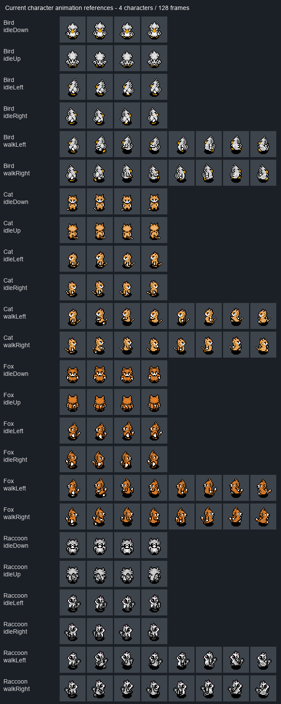

# ProjectMK 그래픽 자원 전체 목록

기준일: 2026-10-19. 아트 적용 전 C++·UMG·실제 DataTable/DataAsset과 이전 그래픽 제작 대화를 대조한 목록이다. 아래 상태 표기는 조사 당시 기준이며, 이후 생성·연결한 115개 PNG와 실제 적용 상태는 [ArtV1 적용 기록](ART_V1_APPLICATION.md)을 따른다.

## 1. 범위와 상태 표기

- **현재 연결:** 게임 데이터나 위젯이 실제 참조하는 기존 자산. 최종 아트 승인을 뜻하지 않는다.
- **제작됨·미적용:** PNG 결과물은 있으나 현재 게임 참조에는 연결되지 않았다.
- **전용 제작 필요:** 임시 아이콘/기본 도형으로 기능만 표현하거나 해당 그림이 없다.
- **선택 개선:** 별도 아트가 없어도 현재 기능이 동작한다. 정식 연출을 강화할 때 만드는 항목이다.
- **보류/시험:** 옛 데이터나 테스트 행. 현재 필수 제작 물량과 구분한다.
- 파일이 많이 들어 있는 외부 에셋 팩 전체를 게임에 필요한 아이템 수로 세지 않는다. 데이터에 등록된 실제 항목을 기준으로 한다.

| 분류 | 확인 수량 | 제작 판단 |
|---|---:|---|
| 현재 BlockDataTable | 8행 | 보이는 7종 + 숨겨진 Border 1종 |
| 마지막 블록 시안 | 기본 4장 + 균열 4장 | 모두 32×32 셀; 게임 미적용 |
| 광맥 시안 | 8장 | v8 PNG 있음; 게임 미적용 |
| 캐릭터 | 4종 | Default는 Bird의 별칭이므로 5종으로 세지 않음 |
| 현재 연결된 캐릭터 애니메이션 | 24클립 / 128프레임 | 1종당 6클립 / 32프레임 |
| 추가 보유 상하 걷기 | 8클립 / 64프레임 | 현재 AnimationDataAsset에는 미연결 |
| 몬스터 | 1종 | DrillCrawler, 현재 정적 아이콘 목업 |
| ItemDataTable | 20행 | 정식 기능/등록 18 + 시험 Ore_Test 1 + 용도 보류 Chain 1 |
| 소모품 | 위 20행 안의 7종 | 별도 7개를 아이템 합계에 중복 가산하지 않음 |
| 레시피 | 8행 | 소모품 레시피 7 + 테스트 레시피 1; 결과 아이콘 재사용 |
| 스킬 | 39행 | 일반 34 + 캐릭터 특성 4 + 빈 NewRow 1 |
| 옛 장비 | 22행 이름 | 행 구조체 없음·현재 데이터 연결/장비 화면 비활성, 보류 |
| UI/효과/배경 | 아래 개별 목록 | 공용 스킨·머티리얼·코드 도형을 중복 장수로 세지 않음 |

## 2. 이전 블록 결과물과 그래픽 매뉴얼

확인한 이전 대화: **공통 픽셀 블록 프롬프트 작성** (thread `01a0e5a1-acfb-7291-b894-8c092b7feb99`). 마지막 블록 수정은 흩어진 용암 점들을 적당히 연결된 틈으로 바꾼 v9다. 그 뒤 광물은 형태·색·면적을 다듬어 v8까지 갔다. 이전 요청과 수정 이력을 대조해 남아 있는 마지막 결과물을 기준 자료로 삼았다.

| 자료 | 실제 파일 | 확인 내용 |
|---|---|---|
| 공통 매뉴얼 | [COMMON_PIXEL_ART_PROMPT.md](COMMON_PIXEL_ART_PROMPT.md) | 공통 영문 프롬프트 및 색상 기준 |
| 마지막 기본 블록 | [blocks.png](../../output/imagegen/blocks-and-overlays-v9/blocks.png) | 128×32, 왼쪽부터 흙·얼음·마그마·돌 |
| 마지막 균열 | [damage-overlays.png](../../output/imagegen/blocks-and-overlays-v9/damage-overlays.png) | 128×32, 손상 20·40·60·80% |
| 마그마 보조 지침 | [magma-prompt.txt](../../output/imagegen/blocks-and-overlays-v9/magma-prompt.txt) | 대부분 굳은 현무암, 내부의 짧고 불규칙하게 연결된 용암 틈 |
| 마지막 광맥 | [mineral-overlays.png](../../output/imagegen/mineral-overlays-v8/mineral-overlays.png) | 128×64, 4열×2행, 광물 8종 |
| 광맥 개별 이미지 | `output/imagegen/mineral-overlays-v8/Ore_*.png` | 각 32×32 |
| 합성 확인 | [preview-blocks.png](../../output/imagegen/mineral-overlays-v8/preview-blocks.png), [preview-damage60.png](../../output/imagegen/mineral-overlays-v8/preview-damage60.png) | 블록 → 광맥 → 균열 순서 |
| 광물별 지침 | [mineral-prompt.txt](../../output/imagegen/mineral-overlays-v8/mineral-prompt.txt) | 광맥의 기존 배치·색 유지, 면적 약 18% 축소 |

이전 답변에는 개별 `magma.png` 등도 언급되지만, 현재 v9 폴더에 실제 남은 PNG는 위 두 시트다. 마그마는 blocks.png의 세 번째 셀에서 가져올 수 있다. 옛 버전이 언급한 파일이 모두 존재한다고 가정하면 안 된다.

공통 매뉴얼은 전체 발주서가 아니라 **스타일용 프롬프트**다. 이 문서가 자원별 목록과 현재 연결 상태를 보완한다.

### 적용할 기존 스타일 규칙

- 논리적 32×32 픽셀 격자, 또렷한 픽셀 덩어리, hard alpha.
- 안티앨리어싱·흐림·부드러운 그라데이션·블룸·서브픽셀 디테일 제외.
- 지형을 색상 기준으로 삼고 재질당 약 3~5단계 색 사용.
- 흙빛 중간톤, 색이 조금 섞인 중성 그림자, 작은 좌상단 하이라이트.
- 일반 광물은 네온/발광 표현을 피하고, 낮은 높이의 박힌 광맥으로 표현.
- 반복 타일은 강한 테두리·중앙 상징·이웃 타일 없이는 어색한 용암 연결부를 피한다.
- 단단한 지형 본체는 셀 전체가 불투명하다. 투명 배경은 광맥·균열·독립 오브젝트의 바깥 영역에 적용한다. 실제 blocks.png 알파는 전부 255, 균열은 0/255다.
- 이미지에 문구를 굽지 않는다. 이름·수량·가격·키 안내는 UI 텍스트로 표시한다.
- UI 패널/건물 전체를 무조건 32×32 한 장에 욱여넣지 않는다. 아이콘은 32×32를 기준으로 하되 패널은 공용 테두리, 건물은 필요한 셀 수로 조합하는 방식이 적합하다. 이는 제작 제안이며 기존 코드 규격 변경은 하지 않았다.

## 3. 블록·지형 전체

| ID/행 | 필요한 그래픽 | 현재 상태 | 제작/연결할 사항 |
|---|---|---|---|
| `Dirt` | 흙 기본 타일 | 기존 world_tileset Sprite_17 사용 | v9 흙 셀로 교체 가능 |
| `Dirt_Grass` | 잔디가 얹힌 지표 흙 | 기존 Sprite_1 | v9 흙과 이어지는 잔디 윗면 전용 타일 필요 |
| `Sand` | 모래 기본 타일 | 기존 Sprite_19 | 단순하고 잘 구분되는 모래 타일 필요; v9에는 없음 |
| `Ice` | 얼음 기본 타일 | 기존 Sprite_39 | v9 얼음 셀 있음; 현재 행은 채굴 불가 설정이므로 아트 교체와 채굴 규칙 변경을 구분 |
| 마그마 | 대부분 굳은 암석과 소량의 용암 틈 | v9 세 번째 셀 있음 | 현재 BlockDataTable에 Magma 행이 없어 시안 보유/향후 적용 항목 |
| `Rock` | 채굴 불가 암석 | 기존 Sprite_25 | v9 돌 셀로 교체 가능; 채굴 가능 지형과 구분 |
| `Shop` | 지상 상점 표식/외관 | 기존 Sprite_57 | 전용 상점 외관·간판 필요; 7절 참고 |
| `SupportBeam` | 설치한 버팀목 | 얼음과 같은 Sprite_39 재사용 | 지지를 제공하는 목재/금속 버팀목 전용 외형 필요 |
| `Border` | 숨겨진 월드 경계 | Sprite_58, bNeedTobeHide=true | 플레이용 그림 불필요; 미니맵에도 표시하지 않음 |

현재 기본 흙 Sprite의 소스 셀은 **16×16**이며 새 시안은 **32×32**다. 월드 블록 한 칸은 현재 16 단위다. 이미지 교체 때는 PaperSprite/TileSet의 셀 크기와 픽셀 대 월드 배율을 맞추고, 콜리전이나 월드 격자를 이미지 해상도만 보고 바꾸지 않는다.

현재 Ice와 Dirt_Grass의 TileIndex가 둘 다 0이다. 이번 목록 작성에서 확인한 데이터 충돌 가능 항목이며 수정하지 않았다. 신규 얼음/마그마 지형을 실제 생성에 넣는 작업은 단순 이미지 제작과 별도다.

### 공용 레이어·블록 상태

| 자원 ID | 필요한 그림/상태 | 현재 상태 |
|---|---|---|
| T-DAMAGE-20 | 20% 균열 1장 | v9 제작됨·미적용 |
| T-DAMAGE-40 | 40% 균열 1장 | v9 제작됨·미적용 |
| T-DAMAGE-60 | 60% 균열 1장 | v9 제작됨·미적용 |
| T-DAMAGE-80 | 80% 균열 1장 | v9 제작됨·미적용 |
| T-CUSHION | 블록 윗면에 바른 완충 젤 | 현재 기본 블록 색만 변경; 전용 투명 코팅 오버레이 권장 |
| T-SUPPORT | 설치 버팀목 정상/손상 상태 | 정상 그림 필요; 손상은 공용 균열 재사용 가능 |
| T-SHAKE | 붕괴 직전 예고 | 현재 위치 흔들림으로 표현; 별도 타일 필수 아님 |
| T-FALL | 낙하·착지 상태 | 기본 타일 이동 재사용; 별도 낙하 타일 불필요 |
| T-BREAK | 파괴 시 먼지·조각 애니메이션 | 기존 12프레임 FX 사용; 스타일에 맞춘 교체는 10절 |
| T-REWARD | 보상 광물이 박힌 블록 | 공용 광맥 8종 사용, 구조물별 그림 중복 제작 불필요 |

온전한 상태는 균열 없음이다. 100% 손상 이미지는 필요하지 않으며 블록을 제거한다. 흙·얼음·마그마별 5장씩 다시 그리는 방식이 아니라 **기본 타일 + 공용 투명 균열 4장** 방식이 최종 요청이다.

현재 손상 표시에는 `Free_Smoke_Fx__Pixel_08`의 10개 키프레임을 정지시켜 쓴다. 전용 균열 4장을 이 경로에 연결할 작업이 남아 있다. 4장 시안을 만들었다는 사실과 현재 게임에서 4단계를 쓴다는 주장은 구분해야 한다.

### 광맥 8종

각각 32×32, 주변과 틈은 투명. 최종 v8 시트 순서는 윗줄 석탄·구리·철·금, 아랫줄 에메랄드·다이아몬드·티타늄·리튬이다.

| 행 | 광맥 제작 상태 | 색/형태 기준 |
|---|---|---|
| `Ore_Coal` | v8 개별 PNG 있음 | 차분한 숯빛·슬레이트 |
| `Ore_Copper` | v8 개별 PNG 있음 | 탁한 적갈색 구리 |
| `Ore_Iron` | v8 개별 PNG 있음 | 중성 철 회색 |
| `Ore_Gold` | v8 개별 PNG 있음 | 낮은 채도의 황토/금빛 |
| `Ore_Emerald` | v8 개별 PNG 있음 | 차분한 비취/옥색 |
| `Ore_Diamond` | v8 개별 PNG 있음 | 밝은 청회색 |
| `Ore_Titanium` | v8 개별 PNG 있음 | 강철빛 회보라 |
| `Ore_Lithium` | v8 개별 PNG 있음 | 탁한 연보라/모브 |

현재 코드는 **ItemIcon 하나를 블록 광물 레이어·월드 드롭·인벤토리 아이콘에 함께 사용**한다. 박힌 광맥과 주운 덩어리를 별도 그림으로 만들려면 참조 필드/선택 경로 분리가 필요하다. 이 문서에서는 광맥 8장과 드롭/UI용 광물 8종을 별도 역할로 적되, 이미 별도 연결되어 있다고 간주하지 않는다.

낙하 구조물 17종은 기존 블록을 배치해 만드는 형태다. 구조물마다 완성 그림 17장을 새로 만들 필요는 없다. 추가 장식물을 붙이는 경우에만 별도 자원으로 잡는다.

## 4. 캐릭터 4종·애니메이션 전수 확인

| 캐릭터 | 데이터 행 | 연결 DataAsset | 원본 시트 |
|---|---|---|---|
| 새 | Default, Character_Bird | DA_Animation_Bird | BIRDSPRITESHEET_White.png |
| 고양이 | Character_Cat | DA_Animation_Cat | CATSPRITESHEET_Orange.png |
| 여우 | Character_Fox | DA_Animation_Fox | FOXSPRITESHEET.png |
| 라쿤 | Character_Raccoon | DA_Animation_Raccoon | RACCOONSPRITESHEET.png |

위 원본은 모두 `Content/Asset/Texture/Character/Sprite/<종류>/`에 있다. 시트 크기 **768×2496**, 연결된 각 PaperSprite 소스 사각형 **192×192**를 실제로 조회했다. 기존 캐릭터 자산을 32×32 완성본으로 잘못 분류하지 않는다. 새 32×32 통일 작업을 한다면 별도 재제작/픽셀 정리와 피벗·스케일 검토가 필요하다.

### 현재 연결된 모든 클립

PlayRate는 DataAsset 값이고, 실제 프레임 속도는 코드의 공통 배수 2를 적용한 값이다. 재생속도 튜닝은 이번에 하지 않았다.

| 캐릭터 | 애니메이션 | 프레임 수 | PlayRate / 실제 속도 | Sprite 번호 | 확인 |
|---|---|---:|---|---|---|
| Bird | `idleDown` 아래/정면 대기 | 4 | 1 / 2fps | 0, 1, 2, 3 | 연결됨·파일 확인 |
| Bird | `idleUp` 위/뒷면 대기 | 4 | 1 / 2fps | 12, 13, 14, 15 | 연결됨·파일 확인 |
| Bird | `idleLeft` 왼쪽 대기 | 4 | 1 / 2fps | 8, 9, 10, 11 | 연결됨·파일 확인 |
| Bird | `idleRight` 오른쪽 대기 | 4 | 1 / 2fps | 4, 5, 6, 7 | 연결됨·파일 확인 |
| Bird | `walkLeft` 왼쪽 걷기 | 8 | 6 / 12fps | 28, 29, 30, 31, 32, 33, 34, 35 | 연결됨·파일 확인 |
| Bird | `walkRight` 오른쪽 걷기 | 8 | 6 / 12fps | 36, 37, 38, 39, 40, 41, 42, 43 | 연결됨·파일 확인 |
| Cat | `idleDown` 아래/정면 대기 | 4 | 1 / 2fps | 0, 1, 2, 3 | 연결됨·파일 확인 |
| Cat | `idleUp` 위/뒷면 대기 | 4 | 1 / 2fps | 12, 13, 14, 15 | 연결됨·파일 확인 |
| Cat | `idleLeft` 왼쪽 대기 | 4 | 1 / 2fps | 8, 9, 10, 11 | 연결됨·파일 확인 |
| Cat | `idleRight` 오른쪽 대기 | 4 | 1 / 2fps | 4, 5, 6, 7 | 연결됨·파일 확인 |
| Cat | `walkLeft` 왼쪽 걷기 | 8 | 1 / 2fps | 28, 29, 30, 31, 32, 33, 34, 35 | 연결됨·파일 확인 |
| Cat | `walkRight` 오른쪽 걷기 | 8 | 1 / 2fps | 36, 37, 38, 39, 40, 41, 42, 43 | 연결됨·파일 확인 |
| Fox | `idleDown` 아래/정면 대기 | 4 | 1 / 2fps | 0, 1, 2, 3 | 연결됨·파일 확인 |
| Fox | `idleUp` 위/뒷면 대기 | 4 | 1 / 2fps | 12, 13, 14, 15 | 연결됨·파일 확인 |
| Fox | `idleLeft` 왼쪽 대기 | 4 | 1 / 2fps | 8, 9, 10, 11 | 연결됨·파일 확인 |
| Fox | `idleRight` 오른쪽 대기 | 4 | 1 / 2fps | 4, 5, 6, 7 | 연결됨·파일 확인 |
| Fox | `walkLeft` 왼쪽 걷기 | 8 | 1 / 2fps | 28, 29, 30, 31, 32, 33, 34, 35 | 연결됨·파일 확인 |
| Fox | `walkRight` 오른쪽 걷기 | 8 | 1 / 2fps | 36, 37, 38, 39, 40, 41, 42, 43 | 연결됨·파일 확인 |
| Raccoon | `idleDown` 아래/정면 대기 | 4 | 1 / 2fps | 0, 1, 2, 3 | 연결됨·파일 확인 |
| Raccoon | `idleUp` 위/뒷면 대기 | 4 | 1 / 2fps | 12, 13, 14, 15 | 연결됨·파일 확인 |
| Raccoon | `idleLeft` 왼쪽 대기 | 4 | 1 / 2fps | 8, 9, 10, 11 | 연결됨·파일 확인 |
| Raccoon | `idleRight` 오른쪽 대기 | 4 | 1 / 2fps | 4, 5, 6, 7 | 연결됨·파일 확인 |
| Raccoon | `walkLeft` 왼쪽 걷기 | 8 | 1 / 2fps | 28, 29, 30, 31, 32, 33, 34, 35 | 연결됨·파일 확인 |
| Raccoon | `walkRight` 오른쪽 걷기 | 8 | 1 / 2fps | 36, 37, 38, 39, 40, 41, 42, 43 | 연결됨·파일 확인 |

1종당 대기 16 + 걷기 16 = **32프레임**, 4종 총 **128프레임**이다. 128개 Sprite 경로의 파일 존재 여부와 SourceUV/SourceDimension/SourceTexture를 조회하고 전체 프레임 모음를 만들었다.

각 종의 `Walk_Down` 8프레임(Sprite 20~27), `Walk_Up` 8프레임(Sprite 44~51)도 폴더에 존재한다. 총 64프레임이 추가 보유되어 있지만 현재 enum/AnimationDataAsset에는 이 두 상태가 없다. 따라서 현재 필수 128프레임과 합쳐 192프레임 모두 게임에서 사용한다고 쓰면 안 된다.

### 캐릭터의 실제 행동별 그래픽 처리

| 행동 | 현재 표현 | 지금 필요한 자원 / 선택 확장 |
|---|---|---|
| 대기 | 방향별 Idle 4프레임 | 기존 4방향 대기 세트 재사용/스타일 통일 |
| 좌우 이동 | Walk_Left/Right 8프레임 | 기존 세트 재사용/스타일 통일 |
| 상하좌우 드릴링 | 해당 방향 Idle **첫 프레임 고정** + 드릴 소품 + 위치 떨림 | 몸통 전용 Drill 애니메이션은 현재 없음; 독립 채굴 동작은 선택 개선 |
| 비행 | Idle 계열 + BalloonSprite 표시 | 전용 Fly 클립 없음; 풍선 그림/연결 필요 |
| 낙하 | 기존 이동/Idle 선택 | 별도 Fall 클립 없음; 선택 개선 |
| 접촉 피해/무적 | 기존 몸통 + 머티리얼 명도 변화 | 전용 Hurt 클립 없음; 피격 플래시/타격 FX는 선택 개선 |
| 넉백 | 피격 전 방향의 Idle 유지 + 물리 궤적 | 뒤집는 그림/뒤걷기 전용 프레임 불필요; HurtPose 추가는 선택 |
| 사망·리스폰 | 기존 페널티·위치 복귀 | 전용 Death/Respawn 애니메이션 없음; 정식 연출 시 추가 |
| 자석 | 코드로 그리는 원형 범위 확대/축소 | 전용 그림 없이 동작; 입자/흡수 FX는 선택 |
| HUD 초상화 | SceneCapture → RT_Portrait → M_UI_Portrait | 캐릭터 정적 초상화 4장을 필수로 중복 제작할 필요 없음; 프레임만 공용 |

상태별 몸통 애니메이션을 추가하기로 할 경우 제작 후보는 각 종의 **Drill 상하좌우, Fly 좌우, Fall 좌우, Hurt 좌우, Death, Respawn**이다. 이는 아직 구현된 클립이나 확정 프레임 수가 아니므로 필수 128프레임에 가산하지 않는다.

### 캐릭터 공용 소품

| 자원 | 필요한 그림 | 현재 연결 상태 |
|---|---|---|
| 기본 드릴 | 기본 외형 1종, 좌우상하 사용 방향 확인 | 네 방향 모두 기존 Sprite_569 1장을 0/±90/180도 회전해 사용 |
| 드릴 작동 | 회전/진동 또는 짧은 스파크 루프 | 몸통 흔들림은 코드; 전용 드릴 애니메이션은 없음 |
| 비행 풍선 | 캐릭터 위에 붙는 풍선과 끈 1세트 | Balloon 폴더에 기존 자산은 있으나 BP_Player BalloonSprite의 SourceSprite는 **None** |
| 소품 방향/피벗 | 몸통과 붙는 위치 및 손잡이 축 | 4종의 실루엣과 간섭 확인 필요; 4방향을 무조건 별도 그림으로 세지 않음 |

## 5. 몬스터 전체

현재 MonsterDataTable은 `DrillCrawler` **1행**이다. 다른 몬스터가 구현되어 있다고 가정하지 않는다. 몬스터 방은 지형 생성 공간이지 별도 몬스터 종이 아니다.

| 행동/요소 | 현재 표현 | 전용 그래픽 제작 목록 |
|---|---|---|
| 본체 | 슬라임 재료와 같은 OreStarter_32_Sprite_31을 재사용 | 드릴 크롤러 고유 실루엣 1종 |
| Idle | 정적 Sprite | 호흡/대기 루프, 좌우 반전 가능하게 제작 |
| 배회 | 정적 Sprite 이동·좌우 반전 | 좌우 이동 루프 |
| 분노 진입 | 본체를 붉게 틴트 | 짧은 화남 예고/표식; 별도 색 스킨 전체 재제작은 필수 아님 |
| 분노 이동 | 같은 Sprite·붉은 틴트 | 이동 루프 재사용 또는 빠른 루프 |
| 채굴 예고 | 가까운 블록 선택, 방향 화살표 | 드릴/몸의 준비 동작 |
| 채굴 | 정적 본체, 방향 화살표, 블록 피해 | 상하좌우 채굴 동작 또는 회전 가능한 공용 드릴 모듈 |
| 피격 | 체력 감소, 분노 재시작 | 짧은 피격 반응/플래시 |
| 낙하 | 정적 본체가 중력으로 이동 | 선택: 공중 자세 |
| 사망 | 액터·위젯 제거 | 선택: 사망/소멸 애니메이션·파티클 |
| 머리 위 UI | IDLE/ROAM/ANGRY 텍스트 + 기본 ProgressBar | 공용 소형 HP 바, 분노 아이콘, 필요 시 이름판 |
| 채굴 방향 표시 | 현재 테스트용 ArrowComponent | 정식 경고 아이콘/블록 강조를 사용할 때 별도 제작 |

현재 몬스터 데이터에는 단일 `Sprite`와 색상 필드만 있다. 위 애니메이션을 제작해도 자동 재생되지 않으며 상태별 Flipbook/클립 연결 확장이 필요하다. 프레임 수는 아직 확정되지 않았다.

## 6. 일반 아이템·소모품 전체 20행

UI·드롭을 같이 쓰면 아이콘을 중복 제작하지 않아도 된다. 단, 광맥은 앞 절에서 설명한 별도 시각 역할을 고려한다.

| 행 | 한글 명칭 | 사용처 | 현재 아이콘 | 제작 상태/할 일 |
|---|---|---|---|---|
| `Coin` | 코인 | 즉시 획득 드롭·HUD·상점 가격 | `item514_Sprite` | 현재 자산 있음; 통일 스타일 아이콘 1개를 공용 사용 |
| `Oxygen` | 산소 드롭 | 즉시 획득 드롭 | `item1195_Sprite` | 현재 자산 있음; 산소 캡슐과 구별 |
| `Ore_Test` | 테스트 광물 | 테스트 레시피 전용 | `world_tileset_Sprite_10` | 정식 제작 제외; 디버그 대체 아이콘 가능 |
| `Ore_Coal` | 석탄 | 광맥·드롭·인벤토리·판매·제작 재료 | `OreStarter_32_Sprite_19` | 광맥 v8 있음; 드롭/아이콘은 별도 형태 권장 |
| `Ore_Copper` | 구리 | 광맥·드롭·인벤토리·판매·제작 재료 | `OreStarter_32_Sprite_50` | 광맥 v8 있음; 드롭/아이콘은 별도 형태 권장 |
| `Ore_Iron` | 철 | 광맥·드롭·인벤토리·판매·제작 재료 | `OreStarter_32_Sprite_58` | 광맥 v8 있음; 드롭/아이콘은 별도 형태 권장 |
| `Ore_Gold` | 금 | 광맥·드롭·인벤토리·판매·제작 재료 | `OreStarter_32_Sprite_55` | 광맥 v8 있음; 드롭/아이콘은 별도 형태 권장 |
| `Ore_Emerald` | 에메랄드 | 광맥·드롭·인벤토리·판매 | `OreStarter_32_Sprite_44` | 광맥 v8 있음; 드롭/아이콘은 별도 형태 권장 |
| `Ore_Diamond` | 다이아몬드 | 광맥·드롭·인벤토리·판매·제작 재료 | `OreStarter_32_Sprite_14` | 광맥 v8 있음; 드롭/아이콘은 별도 형태 권장 |
| `Ore_Titanium` | 티타늄 | 등록 광물·인벤토리·판매 | `OreStarter_32_Sprite_72` | 광맥 v8 있음; 생성 빈도와 무관하게 목록 유지 |
| `Ore_Lithium` | 리튬 | 등록 광물·인벤토리·판매 | `OreStarter_32_Sprite_5` | 광맥 v8 있음; 생성 빈도와 무관하게 목록 유지 |
| `Slime` | 슬라임 재료 | 제작 재료·인벤토리 | `OreStarter_32_Sprite_31` | 현재 광물 팩 아이콘 재사용; 전용 젤 덩어리 아이콘 필요 |
| `Chain` | 사슬 | 등록만 확인 | `없음` | 아이콘 None; 정식 사용 시 제작, 현재 우선순위 보류 |
| `OxygenCapsule` | 산소 캡슐 | 소모품·퀵슬롯·상점 레시피·제작 | `OreStarter_32_Sprite_1` | 전용 아이콘 필요 |
| `RepairKit` | 응급 키트 | 소모품·퀵슬롯·상점 레시피·제작 | `OreStarter_32_Sprite_2` | 전용 아이콘 필요 |
| `RecallFlare` | 귀환 신호탄 | 소모품·퀵슬롯·상점 레시피·제작 | `OreStarter_32_Sprite_3` | 전용 아이콘 필요; 귀환 예고/완료 FX 별도 |
| `SupportBeam` | 버팀목 | 소모품·퀵슬롯·설치 블록·제작 | `OreStarter_32_Sprite_4` | 아이콘과 설치 상태 스프라이트 각각 필요 |
| `CushionGel` | 완충 젤 | 소모품·퀵슬롯·블록 코팅·제작 | `OreStarter_32_Sprite_5` | 아이콘과 발린 젤 오버레이 각각 필요 |
| `BlastCharge` | 발파 폭약 | 소모품·퀵슬롯·설치물·제작 | `OreStarter_32_Sprite_6` | 아이콘/설치물은 공용 가능; 점멸·폭발 FX 별도 |
| `Insurance` | 보험 증서 | 소지형 소모품·상점 레시피·제작 | `OreStarter_32_Sprite_7` | 증서 아이콘 필요; 숫자 키 사용 대상 아님 |

주의할 현재 임시 연결:

- 소모품 7종은 OreStarter_32_Sprite_1~7을 순서대로 빌려 쓴다. 각각 전용 아이콘이 있는 완성 상태가 아니다.
- CushionGel은 Lithium과 같은 Sprite_5를 사용한다.
- Slime과 몬스터 본체도 Sprite_31을 공유한다.
- Chain은 아이콘이 없고 현재 제작 레시피 재료에도 포함되지 않는다. 필요 목록에 남기되 당장 기능에 필요한 그림과 구분한다.
- 일반 아이템 20개를 전부 정식 제작 요청으로 묶으면 시험/미사용 항목까지 섞인다. 현재 기능용 18종을 우선하고 Ore_Test·Chain은 별도 판단한다.

### 레시피 아이콘 전체

| 레시피 행 | 표시명 | 결과물 | 별도 그래픽 |
|---|---|---|---|
| `Recipe_1` | 테스트 데이터 | `Ore_Test` ×1 | 테스트 전용 |
| `Recipe_OxygenCapsule` | 산소 캡슐 | `OxygenCapsule` ×1 | 결과 아이템 아이콘 공용 + 공통 잠금/구매 상태 |
| `Recipe_RepairKit` | 응급 키트 | `RepairKit` ×1 | 결과 아이템 아이콘 공용 + 공통 잠금/구매 상태 |
| `Recipe_RecallFlare` | 귀환 신호탄 | `RecallFlare` ×1 | 결과 아이템 아이콘 공용 + 공통 잠금/구매 상태 |
| `Recipe_SupportBeam` | 버팀목 | `SupportBeam` ×2 | 결과 아이템 아이콘 공용 + 공통 잠금/구매 상태 |
| `Recipe_CushionGel` | 완충 젤 | `CushionGel` ×1 | 결과 아이템 아이콘 공용 + 공통 잠금/구매 상태 |
| `Recipe_BlastCharge` | 발파 폭약 | `BlastCharge` ×1 | 결과 아이템 아이콘 공용 + 공통 잠금/구매 상태 |
| `Recipe_Insurance` | 보험 증서 | `Insurance` ×1 | 결과 아이템 아이콘 공용 + 공통 잠금/구매 상태 |

재료 보유량·필요량·수량·가격은 텍스트다. 레시피마다 재료를 합성한 독립 그림을 새로 만들 필요는 없다. 공통 레시피/잠금 표식이 필요하면 1세트를 재사용한다.

### 옛 장비 데이터 22개 — 현재 제작 보류

`EquipmentItemDataTable`에서 아래 **행 이름**은 조회된다. 하지만 현재 로드된 `RowStruct=None`이라 상세 행 조회가 실패하며, DA_DataTable에도 장비 테이블 연결이 없다. 코드의 InventoryEquipmentWidget은 기존 BP 참조 호환용으로 유지되며 항상 Collapsed 처리된다. 따라서 장비가 현재 정상 장착·표시된다고 간주하지 않는다.

| 옛 행 | 식별용 명칭 | 상태 |
|---|---|---|
| `Helmet_Hair` | 머리/헤어 | 보류·옛 행 이름만 확인 |
| `Helmet_Scrap` | 고철 투구 | 보류·옛 행 이름만 확인 |
| `Helmet_Iron` | 철 투구 | 보류·옛 행 이름만 확인 |
| `Helmet_Knight` | 기사 투구 | 보류·옛 행 이름만 확인 |
| `Helmet_Bunny` | 토끼 머리 장식 | 보류·옛 행 이름만 확인 |
| `Armor_Leather` | 가죽 갑옷 | 보류·옛 행 이름만 확인 |
| `Armor_Iron` | 철 갑옷 | 보류·옛 행 이름만 확인 |
| `Armor_Aluminium` | 알루미늄 갑옷 | 보류·옛 행 이름만 확인 |
| `Armor_Ruby` | 루비 갑옷 | 보류·옛 행 이름만 확인 |
| `Armor_Dark` | 어둠 갑옷 | 보류·옛 행 이름만 확인 |
| `Shoes_Sneakers` | 운동화 | 보류·옛 행 이름만 확인 |
| `Shoes_Slime` | 슬라임 신발 | 보류·옛 행 이름만 확인 |
| `Shoes_Ninja` | 닌자 신발 | 보류·옛 행 이름만 확인 |
| `Shoes_Fire` | 불꽃 신발 | 보류·옛 행 이름만 확인 |
| `Balloon_Sky` | 하늘색 풍선 | 보류·옛 행 이름만 확인 |
| `Balloon_Red` | 빨간 풍선 | 보류·옛 행 이름만 확인 |
| `Balloon_White` | 흰 풍선 | 보류·옛 행 이름만 확인 |
| `Balloon_Gold` | 금색 풍선 | 보류·옛 행 이름만 확인 |
| `Drill_Normal` | 기본 드릴 | 보류·옛 행 이름만 확인 |
| `Drill_Epic` | 에픽 드릴 | 보류·옛 행 이름만 확인 |
| `Drill_Carrot` | 당근 드릴 | 보류·옛 행 이름만 확인 |
| `Drill_Bee` | 벌 드릴 | 보류·옛 행 이름만 확인 |

장비 기능을 되살리는 경우에만 각 항목의 인벤토리 아이콘과 장착 외형을 추가 제작한다. 투구·갑옷·신발은 몸통 프레임에 맞는 위치/방향/변형이 필요하며 단일 32×32 아이콘으로 장착 애니메이션까지 완료되는 것은 아니다. 현재 기본 드릴·풍선 소품은 위 장비 선택 시스템과 별개다.

## 7. 상점·월드 오브젝트·배경

| 자원 ID | 필요한 그림 | 현재 상태 | 우선순위 |
|---|---|---|---|
| W-SHOP | 지상 상점의 눈에 띄는 외관/블록 | world_tileset Sprite_57 | 필수 교체 후보 |
| W-SHOP-SIGN | 판매/구매 장소를 알리는 간판·기호 | 상점 블록 외 별도 참조 없음 | 외관과 합쳐 제작 가능 |
| W-INTERACT | E/클릭 상호작용 안내·강조 | 기능은 있음; 전용 아트 없음 | UI 키캡/강조 공용 |
| W-BEAM | 설치된 버팀목 | 얼음 타일 임시 재사용 | 우선 제작 |
| W-GEL | 블록 위 완충 코팅 | 단순 틴트 | 전용 오버레이 권장 |
| W-CHARGE | 설치한 폭약 | BlastCharge 아이콘 재사용 + 적색 점멸 | 아이콘과 공용 가능 |
| W-CHARGE-WARN | 폭발 전 점멸/위험 영역 | 점멸은 코드 | 위험 반경 표시 그림은 선택 |
| W-SURFACE | 지표 뒤 배경 | 별도 배경 액터/자산 연결 미확인 | 정식 화면 제작 시 필요 |
| W-UNDERGROUND | 지하 빈 공간 뒤 동굴 벽/암반 배경 | 별도 전용 연결 미확인 | 정식 화면 제작 시 필요 |
| W-DEPTH | 깊이에 따른 배경 색/층 변화 | 전용 그래픽 전환 미구현 | 선택 개선 |
| W-PROPS | 지상 시설 주변 소품·표지판 | 현재 확정 배치 없음 | 선택 개선 |
| W-SPAWN | 스폰/귀환 위치 표식 | 위치 기능만 존재 | 선택 개선 |

별도 상인 NPC 캐릭터·상인 초상화·대화 애니메이션은 현재 구현에 없다. 상점을 건물/블록 UI로만 유지하면 NPC 그림은 필수가 아니다. 추가하는 경우에는 별도 기획 범위로 잡는다.

Main 맵의 현재 편집 액터 목록에는 PaperTileMapActor와 플레이어 시작점 등이 있으며, 전용 하늘/동굴 배경 액터는 확인되지 않았다. 따라서 배경 완성본이 이미 연결되어 있다고 표시하지 않았다.

## 8. UI 그래픽 전체

공통 버튼·프레임·아이콘을 재사용한다. 화면마다 완성 배경 PNG를 별도로 그리는 방식보다 테두리/슬롯/바/표식으로 나눠야 해상도·문구·아이템 개수 변화에 대응하기 쉽다.

| 자원 ID | 화면/요소 | 필요한 그래픽 구성 | 현재 상태 |
|---|---|---|---|
| UI-01 | HUD 초상화 | 원형/사각 초상화 프레임 1세트 | 기존 UI_Flat_Frame01a, 실시간 Portrait 재사용 |
| UI-02 | 체력 바 | 공용 바 테두리·빈 바·체력 채움 | UI_Flat_Bar06a / BarFill01c |
| UI-03 | 산소 바 | 공용 테두리·빈 바·산소 채움 | UI_Flat_Bar06a / BarFill01f |
| UI-04 | 상태 상징 | 체력·산소 아이콘 | 상태 색만으로 구분하지 않도록 제작 후보 |
| UI-05 | 코인 HUD | 코인 아이콘·수량 영역 | item514 사용; 아이템 코인과 공용 |
| UI-06 | 인벤토리 창 | 창 배경/테두리·타이틀 영역 | 기존 Flat Theme 프레임 |
| UI-07 | 아이템 슬롯 | 기본/빈 슬롯 배경·선택/호버·비활성 | FrameSlot01b / Select02a_1 |
| UI-08 | 드래그 상태 | 드래그 고스트·놓기 가능/불가 표시 | 아이템 그림 재사용, 전용 강조는 선택 |
| UI-09 | 툴팁 | 패널·제목·아이콘 자리·구분선 | Frame01a, 아이콘은 항목 자산 공용 |
| UI-10 | 하단 퀵바 | 독립 바 배경·8칸 프레임·번호 키캡 | 현재 코드 생성 단색 레이아웃 |
| UI-11 | 퀵슬롯 상태 | 사용 가능/불가·빈 칸·활성/호버 | 현재 색상 변경; 공용 상태 스킨 필요 |
| UI-12 | 귀환 안내 | 대기 표시/진행 바·취소 표시 | 현재 텍스트; 원형/바 연출은 선택 |
| UI-13 | 공통 메뉴 창 | 창 테두리·타이틀·닫기 X | 기존 Frame01a / ButtonCross01a |
| UI-14 | 상점 메뉴 | 판매/레시피 구역·목록 배경·스크롤 | 현재 코드 생성 목업 |
| UI-15 | 판매 행 | 아이콘 슬롯·개별 판매/전체 판매 버튼·가격 기호 | 아이템 그림 재사용; 버튼 스킨 공용 |
| UI-16 | 레시피 구매 행 | 결과 아이콘·잠금·구매 가능/불가·해금 완료 | 아이템 아이콘 재사용; 공용 잠금/체크 필요 |
| UI-17 | 제작 메뉴 | 제작 창·레시피 행·제작 버튼·결과 안내 | C 키 코드 생성 목업 |
| UI-18 | 제작 상태 | 재료 충분/부족·공간 부족·미해금·제작 완료 | 현재 문구/색상; 상태 표식 공용 |
| UI-19 | 스킬트리 | 바탕·노드 프레임·연결선·가지/화살표 | 기존 Flat Theme 요소 재사용 |
| UI-20 | 스킬 노드 상태 | 구매 가능/잠김/구매 완료·호버/선택 | Check01c / Select02a_1 등 |
| UI-21 | 스킬 아이콘 | 아래 38개 유효 행의 아이콘 | 5행만 아이콘 참조 있음, 나머지 유효 33행 없음 |
| UI-22 | 미니맵 프레임 | 테두리·타이틀/좌표 영역 | 코드 생성 단색 프레임 |
| UI-23 | 미니맵 표식 | 플레이어·상점·범례 | 코드 도형; PNG 필수 아님, 스킨화 가능 |
| UI-24 | 미니맵 지형 | 채굴 가능/불가/설치 지형 색 | 코드 사각형; 블록 전체 텍스처를 복제 제작하지 않음 |
| UI-25 | 몬스터 머리 위 | 작은 체력 바·분노 표식 | 기본 ProgressBar + 상태 텍스트 |
| UI-26 | 조작 안내 | A/D/W/S·Space·R·E·C·K·1~8 키캡, 마우스 클릭 | 글자/도형으로 공용 생성 가능 |
| UI-27 | 테스트 패널 | 접기/펼치기·지급/조절/소환 버튼 | PIE 전용; 정식 전용 아트 제작 우선순위 낮음 |
| UI-28 | 공통 버튼 | Normal/Hovered/Pressed/Disabled | 정식 공용 버튼 1세트를 화면 간 재사용 |
| UI-29 | 공통 리스트 | 스크롤바·구분선·선택 행·탭 상태 | 공용 스킨으로 제작 |
| UI-30 | 상태 알림 | 성공·실패·경고·잠금·체크 | 공용 아이콘 세트 |
| UI-31 | 글꼴 | 한글/영문/숫자, 작은 크기 가독성 | 현재 일부 Roboto/엔진 기본 폰트; 최종 UI 폰트 미확정 |

미니맵의 탐험 안개·광물 탐지 아이콘·몬스터 아이콘은 현재 기능에 없다. 필요 시 선택 확장으로 추가한다. 캐릭터 선택 화면, 타이틀·옵션·일시정지·게임오버 화면도 현재 구현 범위에서 확정된 화면이 아니므로 필수 완성 화면 수에 넣지 않았다. 기존 LevelMenu 자산도 최종 게임 흐름이 확정되기 전에는 별도 새 그림을 발주하지 않는다.

### 스킬 아이콘 전체 39행

기존 아이콘이 있는 드릴 파워 3행은 모두 십자 아이콘을 공유하고, 체력 2행은 item688을 공유한다. 최종 의미에 맞춘 아이콘 38개를 개별로 만들거나, 계열별 공용 그림 + 단계 표식으로 묶을 수 있다. 39장 전부가 새로 필요한 것은 아니다. 캐릭터 특성 4종은 데이터상 캐릭터와의 1:1 배정이 확인되지 않아 임의로 Bird/Cat 등에 연결하지 않았다.

| 행 | 표시명 | 종류 | 현재 아이콘 |
|---|---|---|---|
| `Skill_DrillPower_1` | 그저그런 드릴날 | 일반 스킬 | `UI_Flat_IconCross01a` |
| `Skill_DrillPower_2` | 괜찮은 드릴날 | 일반 스킬 | `UI_Flat_IconCross01a` |
| `Skill_DrillPower_3` | 최고급 드릴날 | 일반 스킬 | `UI_Flat_IconCross01a` |
| `Skill_DrillSpeed_1` | 그저그런 드릴 회전축 | 일반 스킬 | `없음` |
| `Skill_DrillSpeed_2` | 괜찮은 드릴 회전축 | 일반 스킬 | `없음` |
| `Skill_DrillSpeed_3` | 최고급 드릴 회전축 | 일반 스킬 | `없음` |
| `Skill_DrillRange_1` | 약간 긴 드릴 손잡이 | 일반 스킬 | `없음` |
| `Skill_DrillRange_2` | 꽤 긴 드릴 손잡이 | 일반 스킬 | `없음` |
| `Skill_HealthBoost_1` | 유산소 운동 | 일반 스킬 | `item688` |
| `Skill_HealthBoost_2` | 근력 운동 | 일반 스킬 | `item688` |
| `Skill_OxygenTank_1` | 미니 산소통 | 일반 스킬 | `없음` |
| `Skill_OxygenTank_2` | 일반 산소통 | 일반 스킬 | `없음` |
| `Skill_OxygenTank_3` | 대형 산소통 | 일반 스킬 | `없음` |
| `Skill_Magnet_1` | 약한 자력장 | 일반 스킬 | `없음` |
| `Skill_Magnet_2` | 강한 자력장 | 일반 스킬 | `없음` |
| `Skill_BagUpgrade_1` | 작은 공구 가방 | 일반 스킬 | `없음` |
| `Skill_BagUpgrade_2` | 큰 군용 가방 | 일반 스킬 | `없음` |
| `Skill_MoveSpeed_1` | 가벼운 장화 | 일반 스킬 | `없음` |
| `Skill_MoveSpeed_2` | 더 가벼운 안전화 | 일반 스킬 | `없음` |
| `Skill_FlyingSpeed_1` | 라텍스 풍선 | 일반 스킬 | `없음` |
| `Skill_FlyingSpeed_2` | 신소재 풍선 | 일반 스킬 | `없음` |
| `Skill_HealthRegen_1` | 침 바르기 | 일반 스킬 | `없음` |
| `Skill_HealthRegen_2` | 연고 바르기 | 일반 스킬 | `없음` |
| `Skill_HealthRegen_3` | 줄기세포 재생 | 일반 스킬 | `없음` |
| `Skill_ChainBreak_1` | 약한 연쇄 채광 | 일반 스킬 | `없음` |
| `Skill_ChainBreak_2` | 강한 연쇄 채광 | 일반 스킬 | `없음` |
| `Skill_Recycler` | 블록 재활용 | 일반 스킬 | `없음` |
| `Skill_AirPocket` | 에어 포켓 | 일반 스킬 | `없음` |
| `Skill_FieldRepair` | 필받은 광부 | 일반 스킬 | `없음` |
| `Skill_Insurance` | 산재 보험 | 일반 스킬 | `없음` |
| `Skill_LuckyStrike` | 약점 공략 | 일반 스킬 | `없음` |
| `Skill_LastOxygen` | 위험한 스릴러 | 일반 스킬 | `없음` |
| `Skill_CoinMaster` | 부의 감각 | 일반 스킬 | `없음` |
| `Skill_Scavenger` | 알뜰 살뜰 | 일반 스킬 | `없음` |
| `CharacterSkill_MinerDiscipline` | 광부 집안 | 캐릭터 특성 | `없음` |
| `CharacterSkill_RecklessDig` | 넘치는 열정 | 캐릭터 특성 | `없음` |
| `CharacterSkill_SpeedRunner` | 가벼운 발걸음 | 캐릭터 특성 | `없음` |
| `CharacterSkill_HeavyCarrier` | 큰 손 | 캐릭터 특성 | `없음` |
| `NewRow` | 이름 없음 | 빈 시험 행·제작 제외 | `없음` |

## 9. 설치물·소모품 사용 연출

| 효과 | 필요한 자원 | 현재 구현과의 관계 |
|---|---|---|
| 산소 회복 | 작은 공기/기포 또는 산소 획득 플래시 | 수치 회복은 구현, 전용 FX는 선택 |
| 체력 회복 | 회복 반짝임/십자 | 수치 회복은 구현, 전용 FX는 선택 |
| 귀환 | 대기 루프·취소 피드백·출발/도착 효과 | 대기/취소/복귀 기능은 구현, FX 추가 연결 필요 |
| 버팀목 설치 | 설치 순간 먼지/짧은 반짝임 | 설치 블록 본체가 우선, FX는 선택 |
| 완충 젤 | 바르는 효과·코팅 잔상 | 현재 틴트; 코팅 그림 우선 |
| 발파 | 퓨즈/점멸·짧은 폭발·먼지/조각 | 점멸과 블록 파괴는 구현, 독립 폭발 애니메이션 추가 필요 |
| 보험 | 보호막/증서 소비 피드백 | 소지형 효과 구현, 전용 FX는 선택 |

## 10. 공용 VFX·피드백

| 자원 ID | 효과 | 최소 제작 역할 | 현재 상태 |
|---|---|---|---|
| FX-01 | 드릴 접촉 | 작은 돌가루/불꽃/충격점 루프 | 몸통 떨림·기존 블록 FX와 별도 역할 |
| FX-02 | 블록 파괴 | 먼지와 파편 원샷 | 기존 BlockBreak1 12프레임, 15fps 연결 |
| FX-03 | 붕괴 착지 | 작은/큰 착지 먼지 | 크기/수량으로 공용 FX 재사용 가능 |
| FX-04 | 낙하 예고 | 부스러기/경고 | 흔들림은 코드; 추가 그림 선택 |
| FX-05 | 아이템 획득 | 작은 흡수 반짝임 | 드롭 아이콘·이동 기능은 있음 |
| FX-06 | 자석 | 범위/흡수 흐름 | 범위 원은 코드 DrawCircle; 별도 원형 PNG 불필요 |
| FX-07 | 플레이어 피격 | 짧은 타격점·플래시 | 무적 머티리얼·넉백은 구현 |
| FX-08 | 몬스터 피격 | 짧은 타격점 | 플레이어 FX와 색/스케일 공용 가능 |
| FX-09 | 몬스터 분노 | 분노 표식/예고 | 현재 붉은 틴트, 별도 표식 필요 |
| FX-10 | 몬스터 채굴 | 드릴 접촉/블록 충격 | FX-01/02 재사용 가능 |
| FX-11 | 사망·리스폰 | 소멸/등장 원샷 | 현재 위치 복귀 중심, 선택 개선 |
| FX-12 | 발파 폭발 | 섬광·연기·돌 조각 원샷 | 전용 폭발 그림/연결 필요 |
| FX-13 | 스킬 발동 | 연쇄·행운·회복·산소·코인 피드백 | 공용 타격/획득/회복 FX로 묶을 수 있음 |
| FX-14 | UI 구매·제작 완료 | 짧은 체크/반짝임 | 정적 공용 아이콘과 간단한 UI 애니메이션으로 가능 |

효과의 프레임 수와 길이는 미확정이다. 블록 원샷은 예를 들어 4~8프레임으로 설계할 수 있지만, 이를 기존 12프레임 자산이나 확정 제작 규격으로 혼동하지 않는다. 효과음 목록은 그래픽 요청 범위에서 제외했다.

## 11. 우선 제작/적용 순서

1. **이미 있는 결과물 활용:** v9 흙·얼음·마그마·돌, 균열 4장, v8 광맥 8장을 기준 자료로 고정한다. 현재 게임 참조와 연결하는 작업을 따로 기록한다.
2. **화면에서 의미가 틀린 임시 자원 교체:** 버팀목, 소모품 7종, 슬라임 재료, 몬스터 본체, 풍선 기본 참조 확인/연결, 상점 외관.
3. **필수 지형 보완:** 잔디 지표·모래·완충 젤 코팅. 얼음/마그마의 실제 생성·채굴 규칙은 아트 작업과 분리해 결정한다.
4. **UI 통일:** 공통 프레임·슬롯·버튼·바·잠금/체크·키캡을 만든 뒤 퀵바·상점·제작·스킬트리·미니맵에 재사용한다.
5. **스킬 아이콘:** 유효 38행을 계열과 단계로 묶어 그림 수를 정한다.
6. **캐릭터/몬스터 연출:** 기존 128프레임의 스타일 유지/교체를 판단하고 몬스터 대기·이동·채굴을 우선 제작한다. 별도 Hurt/Death/Fly 등은 상태 연결 작업과 함께 진행한다.
7. **배경과 FX:** 지상/지하 배경, 발파, 채굴/피격/획득 연출을 정리한다.
8. **보류:** 옛 장비 22개, Chain, Ore_Test/NewRow, 미구현 화면/NPC는 현재 필수 물량에서 제외한다.

단일 총 이미지 장수는 확정하지 않는다. 좌우 반전·드릴 회전·단계 아이콘·공용 패널·런타임 초상화 등 재사용 여부에 따라 달라지며, 위에 표시한 **데이터 행 수/클립 수/실제 PNG 수**가 서로 다른 단위이기 때문이다.

## 12. 확인 근거와 인수 체크

- 실제 조회: Block/Character/Item/Monster/ShopRecipe/Skill DataTable, DA_DataTable 연결, 캐릭터 AnimationDataAsset 4개, BP_Player 소품·초상화 컴포넌트, BP_Block FX, UMG 위젯 트리와 브러시.
- 현재 연결된 캐릭터 128프레임은 모두 파일이 존재하며 소스 셀은 192×192다.
- [원본 데이터·UI 참조 스냅샷](../../output/asset-audit/graphics-audit-2026-10-19.json)
- [캐릭터 프레임별 UV·크기·텍스처](../../output/asset-audit/character-frame-geometry.json)
- [캐릭터 24클립 프레임 모음](../../output/asset-audit/character-animations.png)
- 이후 아트 적용 때는 원본 PNG, PaperSprite 분할, 피벗/월드 크기, 실제 데이터 참조, UI 아이콘, 투명 배경, 블록 경계 반복을 각각 확인한다.
- 광맥과 손상은 정렬·기본 블록 패턴을 유지하고, 단계가 바뀔 때 바탕 무늬가 바뀌지 않게 한다.
- Paper2D 알파 마스크 설정 수정은 이미 적용되어 있다. 새 이미지를 적용하면서 검은 배경을 이미지에 굽거나 불투명 사각형을 재도입하지 않는다.
